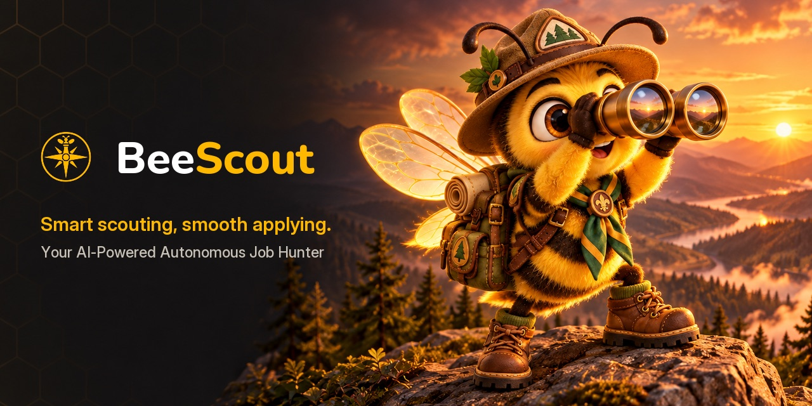
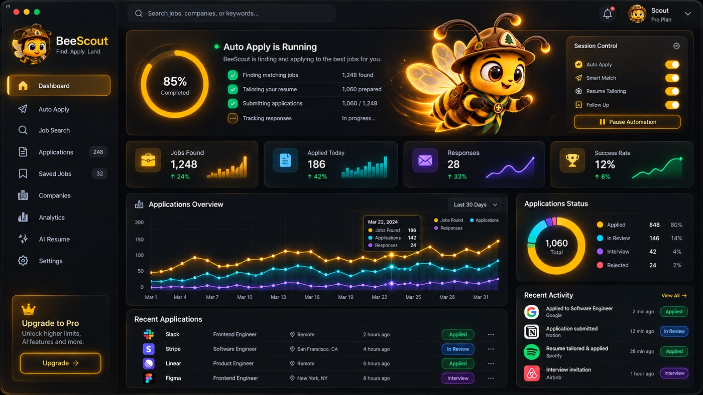

<!-- ═══════════════════════════  HEADER  ═══════════════════════════ -->
<p align="center">
  
</p>

<p align="center">
  <a href="https://burakbuyukyuksel.com">
    
  </a>
</p>

<p align="center">
  <a href="https://burakbuyukyuksel.com"></a>
  <a href="https://linkedin.com/in/buyukyukselburak"></a>
  <a href="mailto:contact@burakbuyukyuksel.com"></a>
  
</p>

<!-- ═══════════════════════════  ABOUT  ═══════════════════════════ -->
<h2>⚡ About me</h2>

<table>
<tr>
<td width="58%" valign="top">

```cpp
struct Burak {
    std::string role     = "Senior C++ Engineer @ GlobalLogic";
    std::string location = "Kraków, Poland 🇵🇱";
    int         years    = 8;

    std::vector<std::string> day_job = {
        "Surgical robotics — Asensus (C++20 · ROS2 · DDS · QNX)",
        "FireTV on Kepler OS — Amazon (React Native · Kotlin)",
        "Camera SDKs — Verizon (C++ · GStreamer · SWIG)",
    };

    std::vector<std::string> side_quests = {
        "struggle.live",     // AI-gamified learning
        "agentnewsie.live",  // multilingual LLM newsroom
        "BeeScout",          // autonomous job hunter
    };

    std::string motto = "Reliability first, then ship it.";
};
```

</td>
<td width="42%" valign="top">

- 🤖 Writing **safety-critical real-time C++** for a remotely operated surgical robot
- 🏭 4+ years at **Otokar** shipping robotics & computer vision to the factory floor
- 🥇 **1st place**, Otokar Changemakers: mask & temperature control on Jetson
- 🧠 Building **AI-native products** end to end: LLM pipelines, agents, full-stack
- 🍓 Everything self-hosted on a **Raspberry Pi 5** with Docker & NGINX
- 💬 Ask me about **robotics, LLM agents, C++ build tooling**

</td>
</tr>
</table>

<!-- ═══════════════════════════  NOW BUILDING  ═══════════════════════════ -->
<h2>🚀 What I'm building now</h2>

<!-- ─────────── struGGle.live ─────────── -->
<a href="https://struggle.live"></a>

<table>
  <tr>
    <td width="36%" align="center" valign="middle">
      
    </td>
    <td width="64%" valign="middle">
      <h3>🎮 <a href="https://struggle.live">struGGle.live</a> &nbsp;</h3>
      <p><b>One topic in. The AI plans the rest.</b></p>
      <p>An AI-powered, gamified micro-learning platform. Type any topic, from Kubernetes to Roman history, and get a personal roadmap:</p>
      <ul>
        <li>🗺️ Editable <b>plan graph</b>: drag, connect and reorder the steps</li>
        <li>⚡ <b>Streamed lessons</b> and interactive exercises</li>
        <li>🔥 <b>XP, streaks</b> and a boss level at the end</li>
        <li>👥 Learn solo or with <b>groups</b>, with a social feed and explore page</li>
        <li>🧩 Multi-provider AI: <b>Claude, OpenAI or local Ollama</b></li>
      </ul>
      <p>
        
        
        
        
        
        
      </p>
    </td>
  </tr>
</table>

<!-- ─────────── AgentNewsie ─────────── -->
<table>
  <tr>
    <td width="64%" valign="middle">
      <h3>📰 <a href="https://agentnewsie.live">AgentNewsie</a> &nbsp;</h3>
      <p><b>News written by machines, read by humans.</b></p>
      <p>A fully automated newsroom for the people living in Poland. It reads the papers so you don't have to:</p>
      <ul>
        <li>🕵️ <b>Scrapes</b> Poland-related news sites and X search results (RSS, HTTP, Selenium)</li>
        <li>✍️ An <b>LLM rewrites</b> each story and scores how critical it is</li>
        <li>🌍 <b>Translates</b> it into 7 languages: 🇵🇱 PL · 🇬🇧 EN · 🇹🇷 TR · 🇦🇿 AZ · 🇰🇿 KK · 🇰🇬 KY · 🇺🇿 UZ</li>
        <li>📣 <b>Publishes</b> to Telegram and a public news site; Instagram and Threads bots built</li>
        <li>🧑‍💼 Operator dashboard and a <b>self-serve advertiser</b> flow</li>
        <li>🍓 Runs 24/7 on a <b>Raspberry Pi</b> (ARM, CPU-only, Docker)</li>
      </ul>
      <p>
        
        
        
        
        
        
      </p>
    </td>
    <td width="36%" align="center" valign="middle">
      <a href="https://agentnewsie.live"></a>
    </td>
  </tr>
</table>

<!-- ─────────── BeeScout ─────────── -->


<table>
  <tr>
    <td width="50%" valign="middle">
      <h3>🐝 BeeScout &nbsp;</h3>
      <p><b>Don't search, BeeScout.</b> Your AI-powered, autonomous job hunter.</p>
      <ul>
        <li>🧭 <b>Finds</b> jobs on the portals you choose</li>
        <li>📝 <b>Fills</b> applications from a profile built from your CV</li>
        <li>🔧 <b>Self-heals</b>: when a site changes, it proposes, tests and asks before fixing its recipe</li>
        <li>✅ <b>Human in the loop</b>: nothing is sent without your approval</li>
        <li>🔒 <b>Local-first</b>, bring your own key (Claude, OpenAI, Gemini…) or run fully local with Ollama</li>
      </ul>
      <p>
        
        
        
        
        
      </p>
    </td>
    <td width="50%" align="center" valign="middle">
      
      <sub><i>Dashboard design concept</i></sub>
    </td>
  </tr>
</table>

<!-- ═══════════════════════════  TECH STACK  ═══════════════════════════ -->
<h2>🛠️ Tech arsenal</h2>

<p align="center">
  <br/><br/>
  <br/><br/>
  <br/><br/>
  
</p>

<p align="center">
  
  
  
  
  
  
  
  
  
</p>

<!-- ═══════════════════════════  CAREER  ═══════════════════════════ -->
<h2>🧭 Career path</h2>

```text
2016 ─┬─ Embedded Systems Lab, Kocaeli Univ.   C/C++ · image processing
2017 ─┼─ Evstek                                MSP430 · ARM · Jetson · OpenCV
2018 ─┼─ Havelsan                              Pardus Linux · PAM · LDAP
2018 ─┼─ Otokar  ████████████████ 4.5 yrs      robotics · computer vision · Go/C#/C++
2023 ─┼─ Luxoft                                C++ customer projects
2023 ─┴─ GlobalLogic ► Asensus · Amazon · Verizon          ◄ you are here
```

<details>
<summary><b>🏆 Industry highlights</b> (click to expand)</summary>
<br/>

| Project | Impact | Stack |
|---|---|---|
| **Surgical robotics** · Asensus | Safety-critical control components and surgeon-behavior simulators for validating operations without hardware | C++20 · ROS2 · RTI DDS · QNX |
| **FireTV on Kepler** · Amazon | Ported FireTV apps to Amazon's new OS from a single shared codebase | React Native · TS · Kotlin · C++17 |
| **Camera SDK bindings** · Verizon | Exposed ToF + RGB camera libs to Python; reproducible multi-arch Docker dev images | C++ · SWIG · GStreamer |
| **ROKOS** · Otokar | Robotic QC line: collision-free trajectories from 3D CAD data and digital twins | C++ · 3D vision |
| **Mask & temperature control** · Otokar | 🥇 1st place, Otokar Changemakers; deployed plant-wide | YOLOv4 · Jetson |
| **Passenger counting** · Otokar | Thermal-camera passenger counting for buses at 90% accuracy | Thermal imaging · C++ |
| **AGV under-vehicle inspection** · Otokar | Replaced manual under-vehicle quality checks with an AGV-mounted imaging system | C++ · Python · Django |

</details>

<!-- ═══════════════════════════  STATS  ═══════════════════════════ -->
<h2>📊 GitHub stats</h2>

<p align="center">
  
  
</p>
<p align="center">
  
</p>

<!-- ═══════════════════════════  OPEN SOURCE  ═══════════════════════════ -->
<h2>📂 Open-source & learning repos</h2>

<p align="center">
  <a href="https://github.com/bbuyukyuksel/training-cpp-build-tools"></a>
  <a href="https://github.com/bbuyukyuksel/design-patterns"></a>
  <a href="https://github.com/bbuyukyuksel/swig-cpp-wrapper-example"></a>
  <a href="https://github.com/bbuyukyuksel/Jetson-NANO-Omron-D6T-44L-06-Driver"></a>
</p>

<!-- ═══════════════════════════  SNAKE  ═══════════════════════════ -->
<p align="center">
  <picture>
    <source media="(prefers-color-scheme: dark)" srcset="https://raw.githubusercontent.com/bbuyukyuksel/bbuyukyuksel/output/github-snake-dark.svg"/>
    
  </picture>
</p>

<!-- ═══════════════════════════  FOOTER  ═══════════════════════════ -->
<p align="center">
  <i>Always happy to talk robotics, AI products, or self-hosting things on a Raspberry Pi.</i><br/>
  <b>Let's build something reliable. 🚀</b>
</p>

<p align="center">
  
</p>
